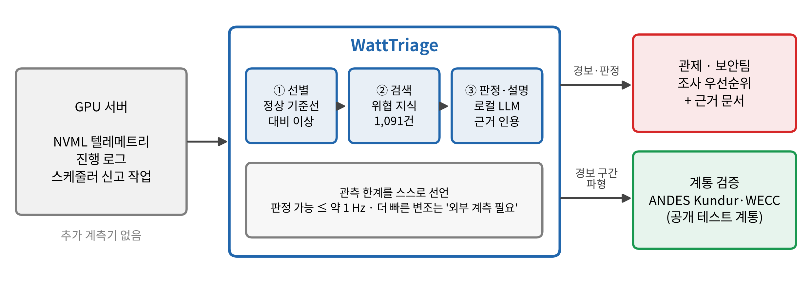
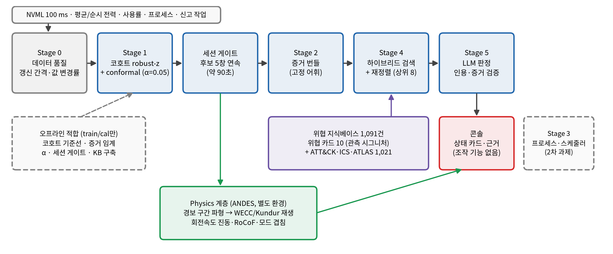
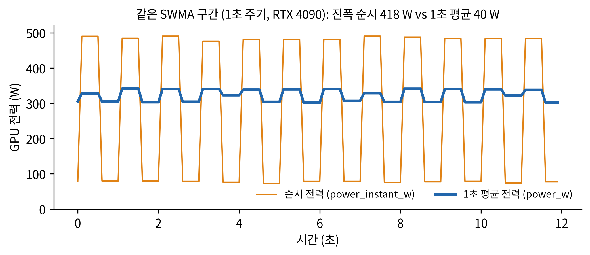
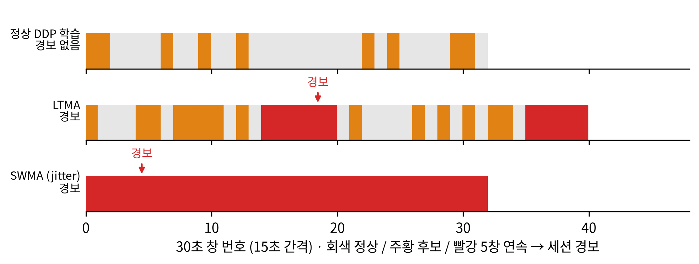
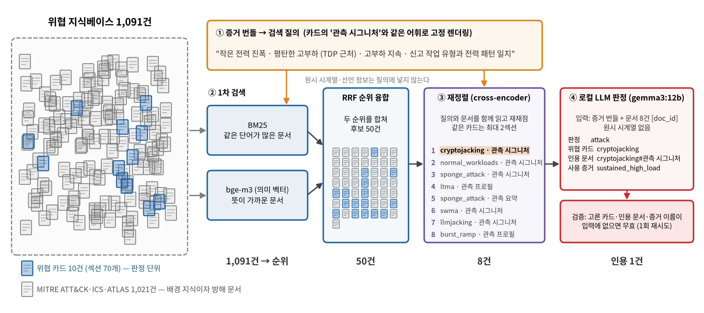
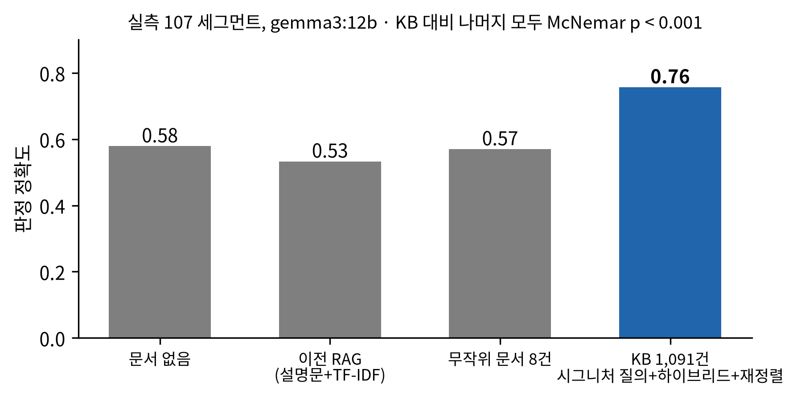
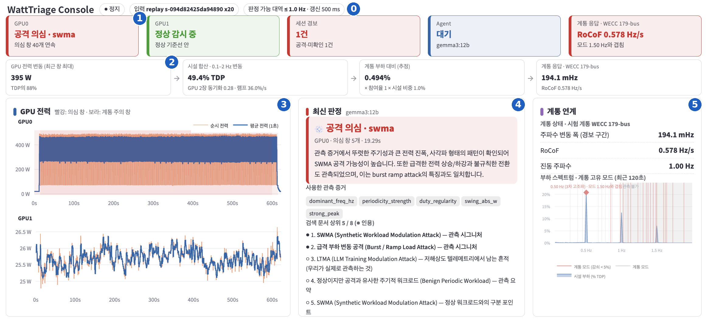
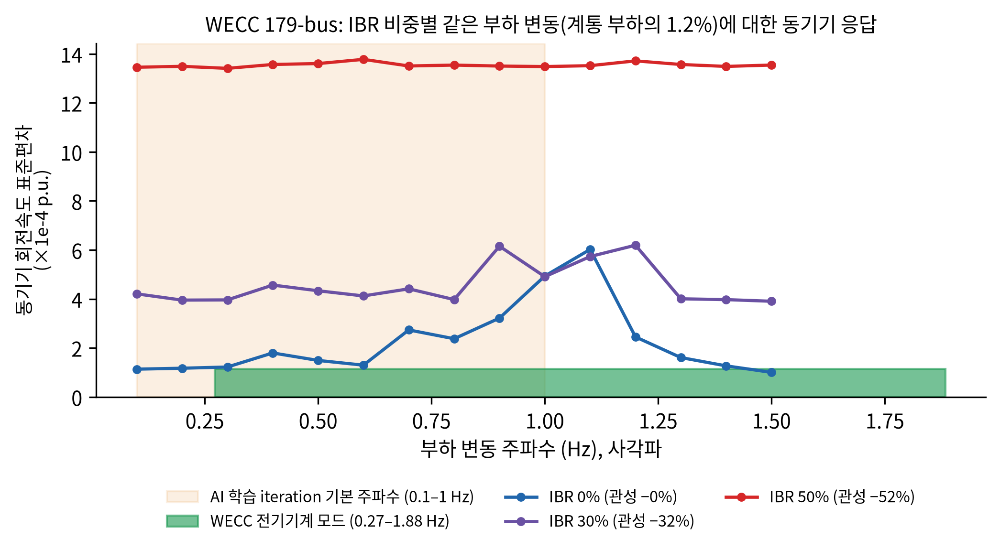

# WattTriage — GPU 텔레메트리 기반 AI 데이터센터 사이버-물리 위협 선별

새 공격이 나올 때마다 탐지 모델을 재학습하는 대신, **범용 이상 필터로 의심 활동을
선별하고, 알려진 공격 시그니처 문서와 RAG로 대조**하는 실용 파이프라인.

> 이전 이름은 GridPulse다. 코드 안의 일부 식별자(`app.py` 제목, 환경변수 `GRIDPULSE_RETRIEVER_DEVICE`,
> CSS 클래스 `gp-*` 등)는 호환을 위해 그대로 둔다.



*추가 계측기 없이 GPU 서버 텔레메트리만으로 선별 → 위협 지식 검색 → 근거 기반 판정을 하고, 경보 구간은 공개 계통 모델(ANDES Kundur·WECC)에서 물리 응답을 확인한다.*

## 설계 근거 (검증된 2-tier IDS 패턴)

이 구조는 침입탐지(IDS) 분야에서 확립된 정석입니다:
- **LLM-Enhanced Two-Tier IDS** (Springer 2026): 가벼운 통계 모니터링으로 상시 감시하다가,
  이상 감지 시에만 무거운 LLM 분석을 on-demand로 촉발 → 우리의 "의심될 때만 고해상도 분석"과 동일.
- **POSEIDON 2-tier IDS**: 이상탐지(1단계) + 시그니처매칭(2단계) 결합.
- 이 패턴은 "하루 1,000개 알람을 40개, 다시 5개로 압축"하는 것으로 실증됨.

**우리가 하지 않는 것**: Bit2Watt의 kHz 원신호를 직접 탐지 (물리 계측 영역, 우선순위 제외).
**우리가 하는 것**: 관측 가능한 해상도에서 의심 활동을 선별 → 알려진 공격과 대조 → 설명 생성.

## 파이프라인 (2-tier)

```
NVML 텔레메트리 (gp-telemetry/1.2)
   ↓
[Stage1 v2] 30s 창 / 15s stride. 선언 코호트 robust-z + Mondrian conformal.
            idle 게이트, 순시 전력(power_instant_w) 증거. 의심 후보만 통과
   ↓ 후보 창이 연속 5개(세션 단위 보정 게이트) 이상인 구간만
[Stage2 v4] evidence bundle → 시그니처 질의 → KB 1,091건 하이브리드 검색(BM25 + bge-m3)
            + bge-reranker 재정렬 → LLM(gemma3:12b) 판정 + 인용·증거 검증
```



*실선은 운영 경로, 점선은 오프라인 적합과 2차 과제다. 임계값·α·세션 게이트는 train/cal 분할로만 정한다.*

실측 공식 경로는 `pipeline/v4_core.py`(일괄·재생·실시간 공유)이며, `run_pipeline.py`의
`--stage2 v2`는 합성 평가용 이전 경로다. 레거시 `--stage1 legacy`는 창 변동폭 z-score 스크리닝이다.

## 저장소에 포함된 것과 빠진 것

- **포함:** 코드, 위협 카드(`corpus/`), 공식 Stage 1 모델 고정본(`models/`, 통계값만), 그림(`docs/figures/`), 수전점 계측 예시(`examples/grid/`, 합성)
- **빠짐(git 제외):** 실측 캡처(`dataset/real/`), ATT&CK·ATLAS 원본(`dataset/kb/raw/`, `scripts/fetch_kb_sources.sh`로 받음)
- 실측 캡처 없이도 콘솔(Live)·판정 경로·테스트가 동작한다. 재학습·평가 스크립트는 `dataset/real/`이 있어야 한다.

## 서버 요구사항 (검증된 환경)

- Ubuntu 22.04, Python 3.10+, CUDA 13.0, RTX 4090 (실측 환경: 4090 x2, 48코어, 125GB RAM)
- GPU 한 장으로 공격/워크로드 재현, 다른 한 장으로 로컬 LLM 서빙 가능

## 설치 및 실행

```bash
bash setup_env.sh          # requirements.txt 설치 + ATT&CK·ATLAS 원본 받기(체크섬 검증) + KB 구축(1,091건)
source .venv/bin/activate
.venv/bin/streamlit run app_v2.py   # 한 화면 콘솔(권장). 저장 세션(dataset/real)이 없으면 Live 모드로 시작
.venv/bin/streamlit run app.py      # 이전 콘솔(v1)

# (선택) 로컬 LLM: 이 서버에는 Ollama 0.32.1이 이미 설치되어 있음
#   ollama serve   # 미실행 시
#   검증된 모델: gemma3:12b  (qwen3:14b는 format=json에서 빈 응답이 나와 비권장)

# 합성: Stage1 v2 + Stage2 v2 (Ollama)
python pipeline/run_pipeline.py \
    --telemetry dataset/synthetic/all_v3.csv \
    --stage1 v2 \
    --stage2 v2 \
    --stage1-config config/stage1_v2.yaml \
    --rag-backend tfidf \
    --llm-backend ollama \
    --llm-model gemma3:12b
```

오프라인/빠른 검증만 할 때는 `--llm-backend stub`을 쓰면 됩니다.

### 합성 데이터셋과 평가

```bash
python dataset/build_synthetic.py
python pipeline/fit_corpus_ranges.py
python pipeline/fit_stage1_v2.py
python pipeline/eval_retrieval.py --telemetry dataset/synthetic/all_v3.csv \
  --split-manifest dataset/synthetic/split_manifest.json --split test
python pipeline/eval_stage1.py
python pipeline/eval_stage2.py --backend stub
pytest -q
```

합성 데이터는 `session_id + gpu_id` 단위로 처리하므로 서로 다른 클래스의
경계가 하나의 분석 윈도우에 섞이지 않는다.
`all_v2.csv`는 하위 호환용 산출물이며 공식 재현 대상은 `all_v3.csv`와
`split_manifest.json`이다.

### 실측 텔레메트리 (gp-telemetry/1.2)

표준: [`dataset/dataset_standard_v1_2.md`](dataset/dataset_standard_v1_2.md).

Collector는 observed만 기록하고, declared/gt는 finalize가 붙인다. 경로는 opaque
`s-<hex>` 세션 ID만 쓰며 라벨 이름을 넣지 않는다.

```bash
# dry-run (GPU 없음): 명령·역할·declared만 확인
python -m dataset.run_capture --workload gpt_tiny_finetune --dry-run
python -m dataset.capture_matrix --dry-run

# 120초 vertical-slice smoke (공유 GPU 안전 확인 후)
bash scripts/gpu_smoke_v2.sh --dry-run
bash scripts/gpu_smoke_v2.sh --confirm-shared-gpu-safe

# 전체 matrix (~22–26h, resume 가능; 승인 후 night shard로 분할)
bash scripts/capture_all.sh --dry-run
bash scripts/capture_all.sh --confirm-shared-gpu-safe --shard 0 --shards 3

# 관측성 (alias / boxcar / period_retention.csv)
python -m dataset.observability dataset/real/sessions --output dataset/real/observability/summary.md
```

이번 매트릭스에는 서로 다른 정상 잡이 한 세션에서 동시에 도는 `mixed_tenants`가 없다.
그래서 `cross_job_sync`의 정상 기준은 없고, 그 지표는 coordinated 공격에서만 관측된다.

`--interval-ms`는 API 호출 요청 주기이지 센서의 물리 측정률이 아니다.
`actual_interval_ms`, `value_changed`와 observability summary로 실효 갱신률을
별도로 확인해야 한다. Nyquist 초과 성분은 `aliased`로 기록하고 folded frequency와
boxcar `sinc` 감쇠를 함께 본다.

### 통제된 실측 워크로드

다른 사용자의 GPU 작업이 없는지 먼저 확인한 다음에만 실행한다.
`--confirm-shared-gpu-safe` 없이는 실부하가 거부된다.

```bash
python -m dataset.run_capture --workload baseline --confirm-shared-gpu-safe
python -m dataset.run_capture --workload swma --period 1 --duty-cycle 0.5 \
  --confirm-shared-gpu-safe
python -m dataset.run_capture --workload gpt_tiny_finetune --duration 120 \
  --confirm-shared-gpu-safe
```

기본 duration은 클래스 공통 pool `{480,600,720}`에서 라벨과 독립적으로 뽑는다.
SWMA 코드는 Bit2Watt persistent kernel의 동일 재현이 아니라, PyTorch CUDA
연산과 sleep으로 소프트웨어 telemetry에서 보이는 규칙적 변동을 만드는 근사다.
2-GPU 캡처는 `distributed` 또는 `swma_multi` workload를 사용한다.

합성 재적합은 기존 `dataset/eval/`을 덮지 않고 `dataset/eval/v2_regen/`에만 쓴다.
먼저 Mondrian baseline을 커밋·태그(`stage1-mondrian-baseline`)한 뒤:

```bash
bash scripts/refit_stage1_v2_regen.sh          # cal only
bash scripts/refit_stage1_v2_regen.sh --run-test  # 동결 후 1회
```

pytest 기본: `pytest -q -m "not gpu"`.

## Stage1 v2 공식 설정



*같은 SWMA 구간(1초 주기)에서 1초 평균 전력은 변조 진폭을 40 W로 지우지만 순시 전력은 418 W를 보존한다. NVML 실효 갱신은 약 500 ms라 판정 가능 대역을 약 1 Hz로 선언한다.*



*정상 DDP 학습은 후보가 흩어져 경보가 없고, LTMA·SWMA는 후보가 5창 연속(약 90초)이 되면 세션 경보가 난다. 실측 교차검증(78세션): 정상 후보율 0.535 → 0.116, 정상 세션 경보 0.052, 관측 가능한 공격 세션 0.781.*

점수 식(u-score / conformal)은 합성·실측이 같다. **코호트 키와 alpha만 갈라진다.**
관측 `mean_w` / `power_band`는 코호트 키에 넣지 않는다.

| | 합성 `config/stage1_v2.yaml` | 실측 `config/stage1_v2_real.yaml` |
|---|---|---|
| 코호트 | `declared_job_family`, `gpu_model` | `declared_job_family`, `expected_band`, `gpu_model` |
| 폴백 | full → family → global | full (세션 3+) → band (세션 2+) → family → global |
| alpha | 0.10 | **0.05** |
| `alpha_high_impact` | 0.20 (impact 완화) | **alpha와 동일** (완화 없음) |
| `progress_log_missing` | 가중치 0 | 가중치 0 (`force_zero_progress_log_missing`) |

실측 `expected_band`는 `declared_job_type`의 고정 표다 (`dataset/declared_context.py`).
high: `llm_pretrain` / `llm_finetune` / `ddp_training`. mid: `vision_training`.
low: `hpo_sweep`, `dataloader_bound`, serving, `notebook`. (`evaluation: low`는 실측 세션 없음.)

Idle 게이트 (관측만, 라벨 미사용):

- 창 `n_procs` 결측 → 같은 `session_id` 중앙값으로 채움. 그래도 없으면 `idle_status=unknown` (후보 불변)
- `n_procs == 0` 이고 `mean_w ≤ 40` → 후보 제외 (`idle`)
- `n_procs == 0` 이고 고전력 → `undeclared_load` (후보)

실측 공식 적합 산출물은 **round5b / fold_00** 이다(`pipeline/v4_core.py`의 `OFFICIAL_STAGE1`).
round5b는 순시 전력 피처(`inst_*`)를 evidence 전용으로 쓰며, `inst_power_unsteady`는
train 정상 코호트 z의 q99에서 켜진다.

- 리포트: `dataset/real/pipeline/refit/round5b/stage1_report.md`
- baseline / calibration: `dataset/real/pipeline/refit/round5b/fold_00/`
- 세션 게이트: `dataset/real/pipeline/refit/session_gate.json` (`pipeline/session_calibration.py`가
  세 fold OOF로 정상 세션 경보 ≤ 0.10이 되는 최소 연속 창 수를 기록, 현재 5). 파일이 없으면 4로 폴백.
- alpha는 cal만. 세션 가중 정상 오탐 ≤ 0.10, 공격 recall 최대, 동점이면 작은 alpha.
  결측 cal 코호트는 같은 코호트 train 오탐으로 대체. test로 alpha/강등하지 않음.

```bash
python pipeline/run_pipeline.py \
  --telemetry dataset/real/pipeline/telemetry_with_procs.csv \
  --stage1 v2 --stage2 none \
  --stage1-config config/stage1_v2_real.yaml \
  --baseline-model dataset/real/pipeline/refit/round5b/fold_00/cohort_baseline_v2.json \
  --calibration dataset/real/pipeline/refit/round5b/fold_00/stage1_v2_calibration.json \
  --sessions-root dataset/real/sessions \
  --progress-source raw \
  --stage1-out dataset/real/pipeline/stage1_real_refit_round5b.json
```

## Stage 2 v4 — 위협 KB 검색과 LLM 판정

KB는 위협 카드 10건(카드당 섹션 분할 70개)과 MITRE ATT&CK Enterprise·ICS 19.2,
ATLAS 5.6.0(기법 1,021건)으로 구성된다. 원본은 `dataset/kb/raw/`(git 제외)에
`enterprise-attack.json`, `ics-attack.json`, `ATLAS.yaml`로 받아 둔다.

```bash
python -m pipeline.kb.build_kb                    # → dataset/kb/kb_docs.jsonl (1,091 docs)
python -m pipeline.stage2_v4_dataset              # round5b로 세그먼트 생성
python -m pipeline.eval_retrieval_v4              # 검색 품질(MRR 등)
python -m pipeline.eval_stage2_v4 --models gemma3:12b --hosts http://127.0.0.1:11434
python -m pipeline.session_calibration            # 세션 게이트 재산출
```

- 질의는 `pipeline/kb/query.py`가 evidence bundle을 카드의 `## 관측 시그니처`와 같은 어휘로
  결정적으로 렌더링한다(가중치 ≥ 1 증거만). 슬롯 프로필 질의(`pipeline/kb/profile.py`)는
  dev에서 유의하게 나빠 **미채택**이며 `build(with_profiles=True)`로만 켜진다.
- 검색 모델은 `GRIDPULSE_RETRIEVER_DEVICE`(기본: 마지막 CUDA 장치)에 올린다.
- `pipeline/stage2_rag_judge.py`의 LLM은 검색된 카드 안에서만 `attack|normal|unobservable|unknown`을
  고르고, 인용 doc_id·증거 이름이 입력에 없으면 1회 재시도 후 무효 처리한다.
- 결과(dev 107 세그먼트, gemma3:12b): 문서 없음 0.579 → 시그니처 질의 + 하이브리드 + 재정렬 0.757
  (McNemar p < 0.001). 처음 보는 오용 공격·신규 정상(23 세그먼트)은 0.04–0.09로 일반화되지 않는다.
  상세: [`RESULTS_v4.md`](RESULTS_v4.md), 설계: [`plan_rag_pipeline_v4.md`](plan_rag_pipeline_v4.md).


*증거 번들을 카드의 관측 시그니처와 같은 어휘로 질의화해 1,091건에서 후보 50건, 재정렬로 8건을 골라 LLM에 넘긴다. 예시는 실측 크립토재킹 세그먼트다.*



- `pipeline/research/`: arXiv·Semantic Scholar·ATT&CK/ATLAS만 쓰는 DRAFT 카드 생성 루프.
  카드 제거 실험에서 unknown 트리거가 발동하지 않아 **실험용**이며, DRAFT는 기본 KB에 들어가지 않는다.

### 실시간·재생 콘솔

```bash
.venv/bin/streamlit run app_v2.py
```

`pipeline/live.py`의 NVML 실시간 소스 또는 저장 세션 재생 소스를 같은 `v4_core` 함수로 채점한다.
파이프라인(검색·LLM) GPU와 감시 GPU가 겹치면 측정 오염 경고를 띄운다.



`app_v2.py`는 관제 요원이 스크롤 없이 첫 화면만 보고 판단하도록 구성했다(`app.py`는 이전 v1).

| 영역 | 내용 |
|---|---|
| ⓪ 상태 줄 | 실행 상태, 입력, 판정 가능 대역·실효 갱신 간격 |
| ① 상태 타일 | GPU별 상태(정상 감시 → 의심 누적 → 경보·분석 중 → 판정, 계통 주의), 세션 경보 수, 판정 LLM, 계통 대표값 |
| ② 규모 환산 흐름 | GPU 변동 → 시설 0.1–2 Hz 변동 → 계통 부하 대비(× 참여율 × 시설 비중) → 계통 응답 |
| ③ GPU 전력 | 평균·순시 전력, 의심 창(빨강)·계통 주의 창(grid_watch, 보라) 음영 |
| ④ 최신 판정 | 판정·위협 카드·설명, 사용 증거, 검색 문서 상위 5건(인용 표시) |
| ⑤ 계통 연계 | 계통 상태(시험 계통 또는 수전점 계측), 부하 스펙트럼–계통 고유 모드 겹침(관측 불가 대역 음영) |
| 상세(스크롤 아래) | 판정 이력과 근거, 계통 흐름·이벤트(부하–계통 주파수 시간 정렬, 이벤트 타임라인), 창 분석, 물리 응답 |

경보까지는 의심 창 5개 연속이 필요해 이상 시작 후 최소 90초(실측 중앙값 90초, 크립토재킹·LTMA 약 150초)가 걸리고,
경보 후 검색과 판정(gemma3:12b 중앙값 9.4초)은 약 10–20초 걸린다. 물리 재생(약 10초)은 판정과 병렬이다.

**GPU 메모리가 부족할 때(임시 운영).** 검색 모델(bge-m3·bge-reranker-v2-m3)은 각각 float32 약 2.1 GiB로,
둘을 GPU에 올리려면 4 GiB 이상이 필요하다.
- 검색 모델을 CPU로: `GRIDPULSE_RETRIEVER_DEVICE=cpu .venv/bin/streamlit run app_v2.py` (검색 중앙값 약 11초).
- 판정을 Anthropic API로: `ANTHROPIC_API_KEY`를 넣고 사이드바 판정 LLM에서 `claude-opus-5-5`를 고른다
  (`pipeline/stage2_rag_judge.py`). 이때 증거 번들과 검색 문서가 외부로 나가므로 공식 평가·시연에는 쓰지 않는다.

**계통 연계 패널**(설계: [`plan_ui_physics.md`](plan_ui_physics.md)):
- 세션 경보가 처음 날 때 그 구간 전력 파형을 `.venv-physics`의 ANDES로 한 번 재생한다
  (`pipeline/physics_bridge.py` → `bit2watt_impl/physics/replay_worker.py`, 약 6초, 캐시).
  진폭은 `(ΔP_GPU/TDP) × 참여율 × 시설 비중`이며 참여율·시설 비중·계통(WECC/Kundur)은 사이드바에서 고른다.
  WECC 고유 모드(`dataset/eval/modal_analysis.json`)와 부하 변동 주파수의 겹침을 함께 표시한다.
  **테스트 계통 민감도이지 현재 계통 상태가 아니다.**
- `pipeline/grid_monitor.py`: 시설 합산 전력의 0.1–2 Hz 변동 진폭·최대 램프·GPU 간 동기화(NVML만 사용),
  부하 스펙트럼과 시간 정렬용 시계열. 계통 측 신호(UPS-MIB 입력 주파수·전압, Redfish PSU, PMU)는 `GridSource`로
  받으며, 지금은 CSV 재생만 구현했다(형식 예시: `examples/grid/`, 합성).
- 물리 재생 결과에는 응답이 가장 큰 발전기의 주파수 편차 파형(10 Hz)이 들어 있어, 콘솔이 경보 구간의 실제 시각에 맞춰 그린다.
- ANDES(GPLv3+)는 `.venv-physics`에만 설치되며, 탐지 엔진(`.venv`)은 하위 프로세스(JSON 입출력)로만 호출한다.

## 구성요소

| 경로 | 역할 |
|---|---|
| `corpus/*.md` | 공격 시그니처 지식베이스. **새 공격은 여기 문서만 추가하면 대응** |
| `pipeline/stage1_v2.py`, `pipeline/baseline.py` | Stage1 v2: 창 피처, 코호트 robust-z, Mondrian, idle 게이트 |
| `pipeline/features.py` | 창 통계 피처 + 정성 설명 (Stage1/Stage2가 공유) |
| `pipeline/v4_core.py`, `pipeline/live.py`, `app_v2.py`, `app.py` | 실측 공식 경로(Stage1 round5b + 세션 게이트 + Stage2 v4), 실시간·재생 엔진, Streamlit 콘솔(v2 권장, v1) |
| `pipeline/physics_bridge.py`, `pipeline/grid_monitor.py` | 경보 구간 물리 재생(하위 프로세스), 시설 자극 지표·계통 측 신호 |
| `pipeline/kb/`, `pipeline/stage2_rag_judge.py` | 위협 KB 구축·질의·하이브리드 검색, LLM 판정·검증 |
| `pipeline/session_calibration.py`, `pipeline/stage1_alternatives.py` | 세션 단위 경보 보정, Stage1 구조 대안(kNN/IForest/CUSUM) 비교 |
| `pipeline/research/` | 정제 출처 기반 DRAFT 카드 생성(실험용) |
| `pipeline/rag_analyzer.py` | 이전 Stage2 RAG(sbert/tfidf) + 레거시 판정 경로(합성 평가용) |
| `pipeline/run_pipeline.py` | 오케스트레이션 (`--stage1 v2`, `--stage2 v2|none`, 선택 `--physics-validate`) |
| `pipeline/fit_corpus_ranges.py` | Part A: train split only로 corpus feature range 산출 |
| `pipeline/fit_stage1_v2.py`, `pipeline/eval_stage1.py`, `pipeline/eval_stage1_auc_alpha.py` | Part B: cohort baseline/conformal + cal-only alpha |
| `pipeline/stage2_evidence.py`, `pipeline/stage2_llm.py`, `pipeline/eval_stage2.py` | Part C: structured evidence bundle과 Stage2 v2 평가 |
| `pipeline/physics_correlation.py` | **§8 실험 전용**: 고정 시나리오 Physics CSV와 cyber JSON을 `attack_id`로 사후 결합(운영 트리거 아님) |
| `dataset/` | 공통 스키마, 합성 데이터, 캡처·평가 도구 |
| `bit2watt_impl/physics/` | 공개 Kundur/WECC 동적 응답 + WECC IBR(교체) 침투율 스윕 |
| `bit2watt_impl/` | NVML 수집(순시 전력 포함), SWMA/LTMA-like 및 오용(LLM-jacking·위장 학습·sponge·burst) 워크로드 |
| `scripts/capture_exclusive.sh`, `scripts/queues/` | GPU 독점 확인 후 캡처 큐 실행(다른 작업 감지 시 세션 폐기) |
| `workloads/` | 정상 PyTorch hard-negative 워크로드 |

## 백엔드 옵션 (이전 `run_pipeline.py --stage2 v2` 경로)

v4 경로의 검색은 `HybridRetriever`(tfidf/bm25/dense/hybrid/hybrid_rerank, 기본 hybrid_rerank)를 쓴다.

- **RAG**: `sbert`(의미 임베딩) / `tfidf`(오프라인 폴백, 모델 다운로드 불필요)
- **LLM**: `ollama`(로컬 경량 모델) / `stub`(LLM 없이 규칙 기반, 파이프라인 검증용)

→ LLM 없이 `--rag-backend tfidf --llm-backend stub`으로 먼저 파이프라인 전체를
   검증하고, 그다음 sbert + ollama로 성능을 올리는 순서를 권장.

## 데이터 누설 방지와 평가 상태

Part A 변경으로 추론 입력에서는 `gt_label`, `gt_attack_id`, `attack_id`,
`waveform_*`, `power_phys_w`, legacy `label`을 제거한다. `declared_job_type`과
`declared_job_family`는 scheduler가 제공하는 선언 context로만 사용되며, 공격명과
같은 oracle 문자열을 넣지 않는다. 실측 `expected_band`도 이 선언 유형 표에서만
유도하고 관측 전력으로 만들지 않는다. 예전 `top1_accuracy=1.0` 주장은 문서 질의와
라벨 context를 함께 쓰던 **누설 포함 상한**으로만 취급한다. 공식 Retrieval 평가는
`--query-context off`에 해당하는 no-context/test-split 결과만 README나 보고서 수치로
사용한다.

## Stage 1 v2 설계 근거 (R1-R10)

- R1: `all_v3.csv`는 `declared_*`와 `gt_*`를 분리해 inference와 evaluation 경계를 명시한다.
- R2: `strip_ground_truth()`가 정답/파형/oracle 컬럼을 제거해 파이프라인 추론 경로 누설을 차단한다.
- R3: 합성 데이터는 NVML 1초 trailing average를 에뮬레이션해 100ms polling과 센서 smoothing 차이를 반영한다.
- R4: 정상 hard-negative는 DDP/FSDP trough, flat pretraining, bursty inference, mixed tenants를 포함한다.
- R5: 공격 variant는 shallow, jitter, piggyback, mimicry, coordinated multi-GPU를 포함해 evasive case를 만든다.
- R6: feature v2는 PSD band power, spectral entropy, Theil-Sen power-util residual, CUSUM changepoint를 포함한다.
- R7: 합성 baseline은 `declared_job_family + gpu_model`. 실측은 `declared_job_family + expected_band + gpu_model`이며 폴백은 full → band → family → global. `expected_band`는 선언 작업 유형 표이며 관측 전력을 키로 쓰지 않는다.
- R8: threshold / alpha는 calibration split만 사용한다. test split은 선택·강등에 쓰지 않는다.
- R9: progress log의 step/checkpoint/eval/request event가 주기와 변화점을 설명할 수 있으나, 현재 합성·실측 모두 `progress_log_missing` 가중치는 0이다.
- R10: 높은 grid impact지만 conformal p-value가 후보 기준을 넘지 않으면 `grid_watch`로 남겨 운영 관찰 대상으로 분리한다. 실측은 `alpha_high_impact = alpha`라 impact만으로 후보를 올리지 않는다.

## Corpus v2와 Stage 2 v2 (R11, R12)

- R11: `corpus/*.md` front-matter는 evidence checklist schema를 사용한다. 숫자 range는 문서에 박지 않고 `pipeline/fit_corpus_ranges.py`가 train split에서 `dataset/eval/corpus_feature_ranges.json`으로 산출한다.
- R12: Stage2 v2는 raw time series나 ANDES 로그를 LLM에 넣지 않고 `stage2_evidence.py`가 만든 structured evidence bundle만 전달한다. LLM 출력은 `known|partial|unknown`, matched/contradicting evidence, fallback 여부를 포함하는 JSON schema로 검증한다.
- Evidence 이름은 `pipeline/evidence_vocab.py`에 고정되어 있으며 (`feature_range_match` 금지), bool 임계값은 train/cal만으로 `fit_evidence_thresholds.py`가 맞춘다.
- Corpus evidence 초안 검토표: `dataset/eval/corpus_evidence_draft_review.md` (**사람 승인 전 공식 Stage2 수치로 주장하지 말 것**).
- Stage2 평가는 `split_manifest`의 test 세션만 사용하고, fallback은 retriever top-1을 쓰며 정상→`benign_periodic` 자동정답 특례는 없다.
- 누설 전/후 표: `dataset/eval/leakage_before_after.json` (`oracle_label` = 누설 포함 상한).
- Stage1 cal AUC / alpha 스윕: `stage1_cal_score_auc.json`, `stage1_alpha_sweep.json` (test는 선택 후 1회).

## 검증 상태

- ✅ features.py: 규칙적 사각파(SWMA류) vs 평평한 고부하(크립토재킹류)를 정성적으로 정확히 구분
- ✅ 합성 v3: 3개 기본 공격 + evasive SWMA 변종 + 6개 기존 정상 + AI datacenter 정상 hard-negative를 세션 경계 없이 생성
- ✅ Stage1 v2: train/cal만 사용해 cohort baseline과 conformal calibration 산출
- ✅ 실측 Stage1 (round5b): expected_band 코호트, alpha=0.05, idle 게이트, 순시 전력 증거.
  미학습 LTMA 창 탐지 0 → 0.318
- ✅ NVML `power_instant_w` 수집 버그(union 필드 오독) 수정 및 기존 세션 복원(`dataset/recover_instant_power.py`)
- ✅ 세션 게이트(5창): 실측 101세션 OOF 정상 세션 경보 0.052, 관측 가능한 공격 세션 0.781
- ✅ Stage2 v4: 판정 정확도 0.579 → 0.757 (dev), 처음 보는 클래스 일반화는 미달
- ✅ `pytest -q`: 236 passed, 1 skipped
- ✅ Retrieval: 공식 수치는 no-context/test split 기준으로 보고하며, 구 `top1_accuracy=1.0`은 누설 포함 상한으로만 표기
- ✅ Stage2 v2: corpus v2 evidence checklist, structured evidence bundle, deterministic stub/fallback 평가 경로 추가
- ✅ NVML idle smoke capture와 observability summary 검증
- ✅ Ollama `gemma3:12b`로 실측 SWMA multi-GPU 후보에 대해 설명형 판정 검증 (`_backend: ollama:gemma3:12b`)
- ✅ Physics Tier B Phase 1: Kundur 7개 프로필 중 6개 수렴, 30% burst는
  `converged=false`로 기록
- ✅ Kundur 스윕: 28개 중 26개 수렴. 전역 `osc_std` peak는 0.1 Hz로,
  약 0.6 Hz 전역 봉우리는 확인되지 않음
- ✅ WECC 179 GENCLS 스윕: 28/28 수렴. 전역 peak는 1.05 Hz로,
  별도 공식 gallery 사례의 0.37 Hz 전역 봉우리를 재현하지 못함
- ⚠ Cyber–physics join의 사용 가능 공격군은 3개뿐이므로 상관계수는 기술통계이며,
  PTPS 수치 가중치는 확정하지 않음

### RTX 4090 제약

- `DCGM_FI_PROF_*`, NVLink, MIG는 사용하지 않는다.
- 메모리 사용량은 NVML을 우선 사용한다.
- 시스템 nvcc 11.5는 Ada `sm_89` 커널 컴파일에 부적합하므로, 실측 workload는
  `.venv`의 CUDA 지원 PyTorch를 사용한다.
- `dataset/real/`은 용량과 개인정보 가능성 때문에 Git에서 제외된다.

## Physics Tier B — 공개 동적 테스트 계통 검증

Cyber Stage 1은 GPU 텔레메트리 후보 선별이다. Physics Tier B에는 세 갈래가 있다.

### 운영 모드 (이벤트 트리거)

Stage 1이 후보로 잡은 **바로 그 윈도우**의 관측 `power(t)`를 공개 테스트계통에
온디맨드로 재생한다. 사후 `attack_id` 매칭이 아니라, 한 번의
`run_pipeline.py` 실행 결과 dict에 `verdict`와 `physics_*`가 함께 들어간다.
기본값은 off이며, ANDES가 있는 `.venv-physics`에서 켠다.

```bash
source .venv-physics/bin/activate
python pipeline/run_pipeline.py \
  --telemetry dataset/synthetic/all_v3.csv --baseline-mean 120 \
  --rag-backend tfidf --llm-backend stub \
  --physics-validate --physics-timeout-s 60 \
  --out dataset/eval/cyber_physics_ops.json
```

### IBR 침투율 스윕 (교체, WECC)



*같은 부하 변동(계통 부하의 1.2%)에서 IBR 비중이 높을수록(관성 32%·52% 감소) 응답이 커진다. 50%에서는 계통 자체 진동(약 1.9 Hz)이 함께 들뜬다. WECC 전기기계 모드는 28개, 0.27–1.88 Hz다.*

소량 IBR **추가**는 용량 비중이 무시할 수준(~0.01%)이라 폐기한다. 대신 공개
WECC 179 GENCLS 동기기를 Sn 내림차순으로 REGCA1(+REECA1)로 **교체**해 용량 기준
침투율(0/30/50/70%)과 관성(`M` 합) 감소를 만든 뒤, 공격 주파수 × 침투율 2D
응답을 본다. KPG-193(Tier A)과 섞어 서술하지 않는다.

```bash
source .venv-physics/bin/activate
python -m bit2watt_impl.physics.ibr_baseline
python -m bit2watt_impl.physics.ibr_frequency_sweep
```

산출: `dataset/eval/ibr_penetration_baseline.csv`,
`ibr_frequency_2d_sweep.csv`, heatmap/overlay PNG, summary JSON.
고침투율에서 PQ 공격 TDS가 실패하면 해당 칸은 `converged=false`로 남긴다.

공간도(지리 좌표 없음 → 선로 그래프 spring layout):

```bash
python -m bit2watt_impl.physics.plot_wecc_ibr_map
# → dataset/eval/wecc_ibr_topology_map.png
# → dataset/eval/wecc_ibr_replacement_order.png
```

### §8 연구 실험 모드 (고정 시나리오 + 스윕)

사전 정의 AttackProfile / 주파수 스윕을 배치로 돌린 뒤, cyber 결과와
`attack_id`로 조인한다. 두 파이프라인의 ID 체계가 다르면 unmatched가 나오며,
이는 운영 트리거 실패가 아니라 실험 설계의 한계다.
`pipeline/physics_correlation.py`는 이 실험 모드 전용이다.

배치 스윕도 GPU W→계통 MW 환산이 아니라 상대 부하 파형 주입이다.
`cyber_amplitude_frac`은 관측 GPU 파형 설명용이고 `amplitude_frac`은 공개
테스트계통 민감도 주입값이며, 둘을 실제 설비 환산으로 해석하면 안 된다.

ANDES 2.0은 Python 3.11 이상이 필요하므로 기존 `.venv`와 분리한다.

```bash
./setup_physics_env.sh
source .venv-physics/bin/activate

# Phase 1: Kundur 정상/주기/버스트/램프 및 GridPulse 공격 프로필
python -m bit2watt_impl.physics.stage1_kundur

# Phase 2: Kundur 0.1~1.45 Hz 스윕
python -m bit2watt_impl.physics.frequency_sweep

# Phase 3: WECC smoke 후 주파수 스윕 (IBR 교체 없음)
python -m bit2watt_impl.physics.stage3_wecc
```

Cyber 결과와 결합 (**§8 실험 모드만**; 운영은 `--physics-validate` 사용):

```bash
source .venv/bin/activate
python dataset/build_synthetic.py
python pipeline/run_pipeline.py \
  --telemetry dataset/synthetic/all_v3.csv --baseline-mean 120 \
  --rag-backend tfidf --llm-backend stub \
  --out dataset/eval/cyber_pipeline_results.json

python pipeline/physics_correlation.py \
  --cyber-json dataset/eval/cyber_pipeline_results.json \
  --physics-csv dataset/eval/kundur_attack_features.csv \
  --out dataset/eval/cyber_physics_joined.csv

source .venv-physics/bin/activate
python pipeline/eval_physics_correlation.py
```

Tier B 결과의 `anomaly_score`는 검증된 물리 위험도가 아니라 Cyber Stage 1의
투명한 0~1 스크리닝 휴리스틱이다. 표본이 부족하면 PTPS 수치 가중치를 확정하지
않고 방향성 제안만 저장한다. 수렴 실패는 누락하지 않고 `converged=false`와
`failure_reason`으로 남긴다.

### 해석 제한

- 결과는 반드시 “공개 동적 테스트 계통(Kundur/WECC)에서”로 한정한다.
- 한국 실제 전력망의 주파수 하락이나 피해 규모로 일반화하지 않는다.
- KPG-193 Tier A(정적·위치별 민감도)와 Tier B(동적·범용 테스트 계통)는 별개다.
- Kundur 내장 케이스의 기존 t=2초 선로 Toggle은 실험 파형과 원인을 분리하기 위해
  비활성화하며, 이 사실을 결과 CSV에 기록한다.

## 확장 (제품 비전)

- `corpus/`에 문서 추가만으로 신종 위협 대응 (재학습 불필요) — MA-IDS의 "경험 라이브러리" 패턴.
  단, 전력 모양이 같은 공격(위장 학습 vs 크립토재킹 등)은 Stage 3(프로세스·스케줄러 증거) 없이는 구분되지 않는다
- 커넥터 아키텍처로 향후 운영 매뉴얼/위협 인텔리전스/외부 데이터 소스를 RAG 컨텍스트에 연결 가능
